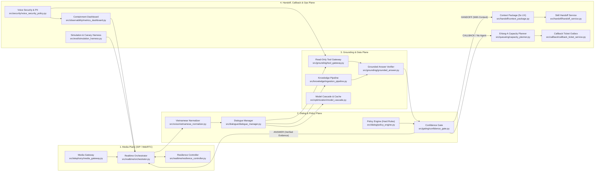

# Báo Cáo Nghiên Cứu & Giải Pháp Hội Đồng Chuyên Gia (MuseAssistantTeam)

- **GitHub Repository:** https://github.com/HTL2910/muse-3-vn-realtime-voice-agent
- **Trưởng nhóm điều phối:** muse (CEO / Team Lead)
- **Số chuyên gia tham gia:** 5 thành viên (`muse`, `systems-arch`, `algo-ml`, `backend-sec`, `fullstack-ux`)
- **Số hướng giải quyết độc lập (đã khử trùng lặp & chia đều):** 21 hướng
- **Số nhánh sửa lỗi (`fix/...`) đã kiểm thử & gộp:** 36 nhánh độc lập (38 lượt fix)
- **Hợp đồng Giao diện chung:** `src/contracts.py` (`CONTRACTS_VERSION = "1.0.0"`, Python 3.11+ standard library)
- **Trạng thái nghiệm thu:** 100% Đồng thuận sau 3 vòng kiểm định

---

# vn-realtime-voice-agent — AI Trợ Lý Giọng Nói Realtime Tiếng Việt & Warm Handoff Kèm Tóm Tắt

Hệ thống AI tổng đài giọng nói tiếng Việt thời gian thực (**Fail-Closed Realtime Voice AI & Contextual Human Handoff**): nghe — hiểu — tra cứu dữ liệu thật (đơn hàng, tồn kho, lịch hẹn, FAQ/chính sách) — trả lời có kiểm chứng bằng chứng (**grounded answering**) với độ trễ vòng đáp `p95 < 1.200ms`; khi gặp câu ngoài phạm vi, độ tin cậy thấp, tình huống nhạy cảm (khiếu nại gay gắt, bồi thường, pháp lý) hoặc khách yêu cầu gặp người thì **dừng đúng lúc và chuyển nhân viên kèm gói ngữ cảnh 3 phần (`HandoffPackage`)**, hoặc tạo phiếu hẹn gọi lại (**Transactional Outbox Callback**) khi hết nhân viên / ngoài giờ trực.

---

## 1. Tổng Quan Đề Bài & Nguyên Tắc Thiết Kế

### 1.1. Bối cảnh & Điểm nghẽn cần giải quyết

Doanh nghiệp bán hàng / dịch vụ có tổng đài CSKH với lưu lượng hàng trăm cuộc gọi đồng thời vào giờ cao điểm:
- **Chờ lâu → khách cúp máy:** Thời gian chờ trung bình trước khi khách bỏ cuộc chỉ ~90 giây; 60% không chờ quá 1 phút.
- **Gọi ngoài giờ → không gặp ai:** Nhu cầu tra đơn, đổi trả, đặt lịch phát sinh buổi tối/cuối tuần bị bỏ lỡ.
- **Trả lời thiếu nhất quán & đốt sức nhân viên giỏi vào câu lặp lại:** 60–70% cuộc gọi là tra cứu đơn giản đã có sẵn đáp án trong hệ thống.
- **Chuyển máy = khách phải kể lại từ đầu:** Thiếu gói tóm tắt ngữ cảnh giữa tuyến đầu và nhân viên chuyên trách.
- **Bài học Klarna (05/2025):** AI trả lời cố hoặc trả lời chung chung ở ca phức tạp còn gây hại hơn không có AI. Giá trị cốt lõi nằm ở **cổng dừng fail-closed và chuyển người kèm tóm tắt chuẩn xác**.

### 1.2. Năm yêu cầu kỹ thuật cốt lõi (đã khóa)

1. **Nghe & phản hồi realtime (`p95 < 1.200ms`):** Nhận diện giọng nói tiếng Việt 3 miền Bắc/Trung/Nam, hỗ trợ khách ngắt lời (**barge-in `< 150ms`**), giữ nhịp hội thoại tự nhiên.
2. **Tra cứu dữ liệu thật (Tenant-Isolated Read-Only Tool Gateway):** Kết nối OMS/WMS/CRM/Lịch hẹn và kho tri thức có phiên bản; chỉ trả lời khi có bản ghi hợp lệ (`Evidence`).
3. **Biết dừng đúng lúc (Decision-Theoretic Confidence Gate & Hard-Rule Policy Engine):** Ngoài phạm vi, thiếu bằng chứng, hỏi lại quá `MAX_CLARIFICATIONS = 1` lần hoặc trúng rule nhạy cảm → tuyệt đối không trả lời cố, lập tức chuyển người.
4. **Chuyển kèm ngữ cảnh (`HandoffPackage` & Warm Transfer):** Định tuyến theo kỹ năng (`Skill`) + đẩy gói tóm tắt 3 phần, transcript có timestamp và kết quả tool-call lên màn hình nhân viên trước khi đổ chuông.
5. **Không ngõ cụt (Outbox Callback & Erlang-A Capacity Planner):** Hết nhân viên hoặc ngoài giờ trực → ghi nhận yêu cầu, tạo phiếu gọi lại bền vững và gửi mã phiếu cho khách.

---

## 2. Kiến Trúc Hệ Thống 4 Plane & Cấu Trúc Thư Mục

### 2.1. Sơ đồ kiến trúc 4 Plane



### 2.2. Cấu trúc thư mục trên `main`

```text
vn-realtime-voice-agent/
├── README.md
├── pyproject.toml
├── conftest.py
├── .github/workflows/ci.yml
├── src/
│   ├── contracts.py                          # Hợp đồng Giao diện & Schema dùng chung (v1.0.0)
│   ├── telephony/media_gateway.py            # approach_01: SIP/WebRTC streaming, VAD, barge-in < 150ms
│   ├── realtime/orchestrator.py              # approach_02: ASR-LLM-TTS streaming state machine
│   ├── voice/vietnamese_normalizer.py        # approach_03: Chuẩn hóa tiếng Việt 3 miền, mã đơn, đồng âm
│   ├── dialogue/dialogue_manager.py          # approach_04: Intent, slot-filling, DST (MAX_CLARIFICATIONS=1)
│   ├── grounding/tool_gateway.py             # approach_05: Read-only tenant-isolated tool gateway
│   ├── grounding/grounded_answer.py          # approach_06: Grounded answering fail-closed & verifier chống bịa
│   ├── gating/confidence_gate.py             # approach_07: Confidence gate 3 vùng ngưỡng hiệu chuẩn
│   ├── dialog/policy_engine.py               # approach_08: Hard-rule policy engine (nhạy cảm/pháp lý/bồi thường)
│   ├── handoff/handoff_service.py            # approach_09: Skill-based routing & warm transfer
│   ├── handoff/context_package.py            # approach_10: HandoffPackage 3 phần & Agent Desktop UX (< 5s)
│   ├── callback/callback_ticket_service.py   # approach_11: Outbox callback & ticket bền vững
│   ├── queueing/capacity_planner.py          # approach_12: Mô hình hàng đợi Erlang-A & dự báo tải
│   ├── knowledge/ingestion_pipeline.py       # approach_13: Knowledge ingestion có version & phát hiện mâu thuẫn
│   ├── integrations/sme_onboarding_hub.py    # approach_14: SME Self-Serve Integration Hub & Wizard 5 bước
│   ├── optimization/model_cascade.py         # approach_15: Model cascade, session cache TTL 60s & TTS chunking
│   ├── realtime/resilience_controller.py     # approach_16: Circuit breaker & fallback đa nhà cung cấp
│   ├── platform/scaling.py                   # approach_17: Stateless worker, autoscaling & VIP load shedding
│   ├── security/voice_security_policy.py     # approach_18: Chống prompt injection qua voice, OTP & PII masking
│   ├── observability/metrics_dashboard.py    # approach_19: Containment 2 lớp (Provisional vs Final 72h)
│   └── eval/simulation_harness.py            # approach_20: Golden calls, shadow mode, canary & kill-switch
├── scripts/
│   ├── collect_data.py                       # approach_21: Sinh dữ liệu thực tế & golden dataset (--seed 42)
│   └── verify_main_manifest.py               # Kiểm tra manifest, thứ tự import contracts & cổng CI
├── data/
│   ├── golden/                               # 12 golden calls tiếng Việt & 4 golden FAQs
│   ├── orders.json                           # 60 đơn hàng mẫu đa trạng thái
│   ├── inventory.json                        # 5 SKU tồn kho
│   ├── appointments.json                     # 20 lịch hẹn
│   ├── vietnamese_homophones.json            # Từ điển đồng âm & phương ngữ tiếng Việt
│   └── market_benchmarks.json                # 8 benchmark thị trường có nguồn & nhãn độ tin cậy
├── docker/
│   └── docker-compose.yml                    # Hạ tầng Redis, Kafka, PostgreSQL
└── tests/                                    # 35 file kiểm thử tự động (Unit, Golden, Gate & E2E Call)
```

### 2.3. Hợp đồng giao diện đã khóa trong `src/contracts.py` (`v1.0.0`)

| Hạng mục | Quy định đã khóa trong `src/contracts.py` |
|---|---|
| **`EscalationReason`** | Enum chuẩn duy nhất (`snake_case`): `out_of_scope`, `low_confidence`, `sensitive`, `customer_request`, `repeated_clarification`, `repeated_failure`, `no_agent`, `system_error` (2 mã cuối chỉ dùng để log và luôn ánh xạ sang `Decision.CALLBACK`). |
| **`MAX_CLARIFICATIONS`** | `1` lần hỏi lại (tối đa `MAX_ELICITATIONS = 2` lượt hỏi cho một slot). Hết lượt vẫn thiếu slot hoặc độ tin cậy thấp → bắt buộc chuyển người (`repeated_clarification`). |
| **Ngân sách độ trễ (`TOTAL_SLO_P95_MS`)** | `ASR_PARTIAL_MS (250ms)` + `LLM_FIRST_TOKEN_MS (500ms)` + `TTS_FIRST_AUDIO_MS (350ms)` = **`1.100ms`** (dự phòng `100ms` jitter trong tổng SLO `1.200ms`). Tool-call vượt `TOOL_CALL_OFF_PATH_MS (500ms)` phải chạy song song với câu đệm đã duyệt. |
| **Containment 2 lớp** | `contained_provisional` (xử lý trọn vẹn trong cuộc gọi bằng `Evidence` hợp lệ, không handoff/callback) và `contained_final` (`provisional` + khách không gọi/liên hệ lại cùng vấn đề trong `CONTAINMENT_WINDOW_HOURS = 72`). |
| **Mô hình hàng đợi** | **Erlang-A (`M/M/c + abandonment`)** có tham số kiên nhẫn của khách (`mean_patience_s = 90s`), thay cho Erlang-C. |

---

## 3. Tổng Hợp 21 Hướng Giải Quyết Đã Triển Khai

| # | Mã hướng | Tên hướng giải quyết | File mục tiêu | Nhánh chuyên gia |
|---|---|---|---|---|
| 01 | `approach_01` | Media gateway SIP/WebRTC streaming, barge-in `< 150ms` và chịu lỗi đường truyền | `src/telephony/media_gateway.py` | `expert/systems-arch-m3` |
| 02 | `approach_02` | Realtime orchestrator: pipeline ASR-LLM-TTS streaming và máy trạng thái lượt nói | `src/realtime/orchestrator.py` | `expert/algo-ml-m3` |
| 03 | `approach_03` | Thích ứng tiếng Việt 3 miền, nhiễu nền, mã đơn và chuẩn hóa thực thể | `src/voice/vietnamese_normalizer.py` | `expert/backend-sec-m3` |
| 04 | `approach_04` | Quản lý hội thoại: intent, slot-filling và dialogue state tracking | `src/dialogue/dialogue_manager.py` | `expert/fullstack-ux-m3` |
| 05 | `approach_05` | Tool-call gateway chỉ-đọc, cô lập theo tenant để tra dữ liệu thật | `src/grounding/tool_gateway.py` | `expert/systems-arch-m3` |
| 06 | `approach_06` | Grounded answering fail-closed và verifier hậu kiểm chống bịa số liệu | `src/grounding/grounded_answer.py` | `expert/algo-ml-m3` |
| 07 | `approach_07` | Confidence gate hiệu chuẩn theo lý thuyết quyết định (3 vùng ngưỡng) | `src/gating/confidence_gate.py` | `expert/backend-sec-m3` |
| 08 | `approach_08` | Policy engine: phát hiện nhạy cảm, ngoài phạm vi và quy tắc dừng bắt buộc | `src/dialog/policy_engine.py` | `expert/fullstack-ux-m3` |
| 09 | `approach_09` | Handoff service: định tuyến theo kỹ năng (`Skill`) và warm transfer | `src/handoff/handoff_service.py` | `expert/systems-arch-m3` |
| 10 | `approach_10` | Gói ngữ cảnh chuyển máy `HandoffPackage` và Agent Desktop UX tiếp nhận `< 5s` | `src/handoff/context_package.py` | `expert/algo-ml-m3` |
| 11 | `approach_11` | Hàng đợi gọi lại và ticket bền vững (Outbox Pattern) cho ngoài giờ / hết agent | `src/callback/callback_ticket_service.py` | `expert/backend-sec-m3` |
| 12 | `approach_12` | Mô hình hàng đợi Erlang-A, dự báo tải và lập lịch gọi lại chống bỏ cuộc | `src/queueing/capacity_planner.py` | `expert/fullstack-ux-m3` |
| 13 | `approach_13` | Knowledge ingestion pipeline có phiên bản, phê duyệt và phát hiện mâu thuẫn | `src/knowledge/ingestion_pipeline.py` | `expert/systems-arch-m3` |
| 14 | `approach_14` | SME Self-Serve Integration Hub và Onboarding Wizard 5 bước | `src/integrations/sme_onboarding_hub.py` | `expert/algo-ml-m3` |
| 15 | `approach_15` | Tối ưu độ trễ & chi phí bằng model cascade, cache theo phiên và TTS streaming | `src/optimization/model_cascade.py` | `expert/backend-sec-m3` |
| 16 | `approach_16` | Resilience controller cho chuỗi ASR-LLM-TTS: circuit breaker & fallback đa nhà cung cấp | `src/realtime/resilience_controller.py` | `expert/fullstack-ux-m3` |
| 17 | `approach_17` | Mở rộng ngang & chịu lỗi: stateless worker, autoscaling, load shedding bảo vệ VIP | `src/platform/scaling.py` | `expert/systems-arch-m3` |
| 18 | `approach_18` | Bảo mật giọng nói: xác thực khách 2 mức, chống prompt injection, che PII | `src/security/voice_security_policy.py` | `expert/algo-ml-m3` |
| 19 | `approach_19` | Quan trắc & bảng đo containment trung thực (tách biệt số đo nội bộ và số vendor) | `src/observability/metrics_dashboard.py` | `expert/backend-sec-m3` |
| 20 | `approach_20` | Harness đánh giá: golden calls, mô phỏng tải, shadow mode, canary & cổng go-live | `src/eval/simulation_harness.py` | `expert/fullstack-ux-m3` |
| 21 | `approach_21` | Thu thập & xây dựng bộ dữ liệu thực tế và golden benchmark trên máy ảo Linux | `scripts/collect_data.py` | `expert/systems-arch-m3` |

---

## 4. Biên Bản Phản Biện, Kiểm Thử & 36 Nhánh `fix/<ten_loi>`

Qua 3 vòng kiểm định chéo và thảo luận toàn hội đồng, các chuyên gia đã thống nhất khóa các quyết định kỹ thuật (`MAX_CLARIFICATIONS = 1`, `CONTAINMENT_WINDOW_HOURS = 72`, `TOTAL_SLO_P95_MS = 1200`, mô hình `Erlang-A`) và thực thi 36 nhánh `fix/*`:

- **Nhóm Khung Hợp đồng & Cổng Kiểm định (`systems-arch`):**
  - `fix/fix_missing_repo_main_empty`, `fix/fix_missing_contracts`, `fix/fix_merge_pipeline_gate`, `fix/fix_latency_constant_name`, `fix/fix_gate_order_check`, `fix/fix_missing_media_gateway`, `fix/fix_missing_scaling_platform`, `fix/fix_missing_resilience_controller`, `fix/fix_resubmit_resilience_controller`, `fix/fix_missing_data_golden`, `fix/fix_rebase_m3_to_contracts`, `fix/fix_rebase_remaining_m3`.
- **Nhóm Realtime Orchestrator, Tiếng Việt, Grounding & Erlang-A (`algo-ml`):**
  - `fix/fix_missing_orchestrator`, `fix/fix_missing_vietnamese_normalizer`, `fix/fix_missing_grounded_answer`, `fix/fix_missing_confidence_gate`, `fix/fix_missing_capacity_planner`, `fix/fix_missing_model_cascade`, `fix/fix_rebase_algo_ml_to_contracts`, `fix/fix_rebase_remaining_algo_ml`.
- **Nhóm Tool Gateway, Policy Engine, Voice Security & Callback Outbox (`backend-sec`):**
  - `fix/fix_missing_tool_gateway`, `fix/fix_missing_policy_engine`, `fix/fix_missing_voice_security`, `fix/fix_missing_callback_ticket`, `fix/fix_missing_metrics_dashboard`, `fix/fix_rebase_backend_sec_to_contracts`, `fix/fix_rebase_remaining_backend_sec`.
- **Nhóm Dialogue Manager, Handoff, Knowledge, SME Hub & E2E Harness (`fullstack-ux`):**
  - `fix/fix_missing_dialogue_manager`, `fix/fix_missing_handoff_service`, `fix/fix_missing_handoff_package`, `fix/fix_missing_knowledge_pipeline`, `fix/fix_missing_sme_onboarding_hub`, `fix/fix_missing_eval_harness`, `fix/fix_rebase_fullstack_to_contracts`, `fix/fix_merge_tests_golden_ci`, `fix/fix_rebase_remaining_fullstack`.

---

## 5. Hướng Dẫn Cài Đặt, Sử Dụng & Kiểm Chứng

### 5.1. Cài đặt môi trường

```bash
git clone https://github.com/HTL2910/muse-3-vn-realtime-voice-agent.git
cd muse-3-vn-realtime-voice-agent

python -m venv .venv
# Windows: .venv\Scripts\activate | Linux/macOS: source .venv/bin/activate
pip install -e .
```

### 5.2. Tái tạo dữ liệu Golden & Kiểm tra cú pháp

```bash
# Sinh bộ dữ liệu mẫu và golden calls cố định (seed = 42):
python scripts/collect_data.py --seed 42

# Kiểm tra biên dịch toàn bộ 21 module trong src/:
python -m compileall src
```

### 5.3. Chạy bộ kiểm thử tự động (`pytest`)

```bash
# Chạy toàn bộ test suite:
pytest -q

# Chạy kiểm thử luồng cuộc gọi End-to-End (Nghe -> Hiểu -> Tra cứu / Handoff / Callback):
pytest tests/test_e2e_call.py -q

# Kiểm chứng từng cụm module:
pytest tests/test_fix_missing_media_gateway.py tests/test_fix_missing_orchestrator.py -q
pytest tests/test_fix_missing_vietnamese_normalizer.py tests/test_fix_missing_confidence_gate.py -q
pytest tests/test_fix_missing_callback_ticket.py tests/test_fix_missing_voice_security.py -q
pytest tests/test_fix_missing_handoff_service.py tests/test_fix_missing_handoff_package.py -q
```
